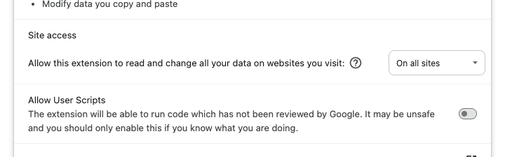
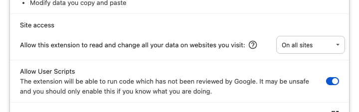
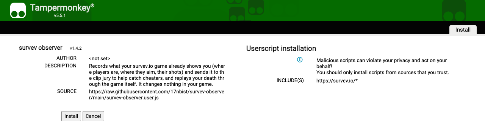
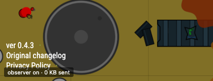
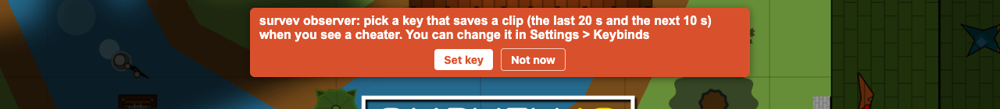

# Install the survev observer (about 2 minutes, no programming)

The observer records what your game already shows you and sends it to the clip jury, so more cheaters get caught. It
changes nothing in your game. Full details: [README](../README.md).

These steps are for **Chrome** (Brave, Opera and other Chrome-based browsers are the same). Firefox and Edge: see the
end.

## 1. Install Tampermonkey

Open [Tampermonkey in the Chrome Web Store](https://chromewebstore.google.com/detail/tampermonkey/dhdgffkkebhmkfjojejmpbldmpobfkfo)
and click **Add to Chrome**, then **Add extension**. It may open a welcome tab: close it.

## 2. Turn on "Allow User Scripts" (do not skip this)

Chrome blocks Tampermonkey's scripts until you allow them. Without this step everything looks installed, but nothing
runs.

1. Copy this into the address bar and press Enter: `chrome://extensions/?id=dhdgffkkebhmkfjojejmpbldmpobfkfo`
   (or: click the puzzle piece next to the address bar, then the three dots next to Tampermonkey, then **Manage extension**).
2. Scroll down to **Allow User Scripts** and switch it on.

| Before | After |
|---|---|
|  |  |

## 3. Install the observer

Open [survev-observer.user.js](https://raw.githubusercontent.com/17nbist/survev-observer/main/survev-observer.user.js).
Tampermonkey shows this page. Click **Install**.

## 4. Check it works

Open [survev.io](https://survev.io/) (reload it if it was already open). In the bottom left corner you should see
**observer on**:

That's it. Play as normal. The number goes up as it sends your matches. Click the label to pause it.

## 5. Pick a clip key (optional)

The first time, the menu shows an orange bar. Click **Set key** and press the key (or mouse side button) you want. In a match,
press it when you see something odd: it keeps the last 20 seconds and the next 10. Watch your clips from **▶ N clips** next to the
label, or from the results screen. Change the key later in survev's **Settings > Keybinds** (**Save clip (observer)**), or click
**Not now** if you do not want one.

## If the label does not show

- Go back to step 2: **Allow User Scripts** being off is the usual cause.
- Click the Tampermonkey icon (under the puzzle piece) on survev.io: **survev observer** should be listed and switched on.
- Reload survev.io.

## Firefox and Edge

- **Firefox**: install [Tampermonkey for Firefox](https://addons.mozilla.org/firefox/addon/tampermonkey/), then do
  steps 3 and 4. There is no step 2.
- **Edge**: install Tampermonkey from the Edge Add-ons store. Open `edge://extensions`, click **Details** under
  Tampermonkey and switch on **Allow User Scripts** (on older Edge: switch on **Developer mode** on that page instead).
  Then steps 3 and 4.

---

*This guide is checked by a script: [e2e.mjs](e2e.mjs) runs steps 1 to 5 in a headless Chrome, takes these screenshots,
and fails if the label does not show. It stops at the menu and never joins a match. Its control run (`--skip-toggle`)
checks that step 2 is really needed. The Firefox and Edge notes are not covered by it.*
